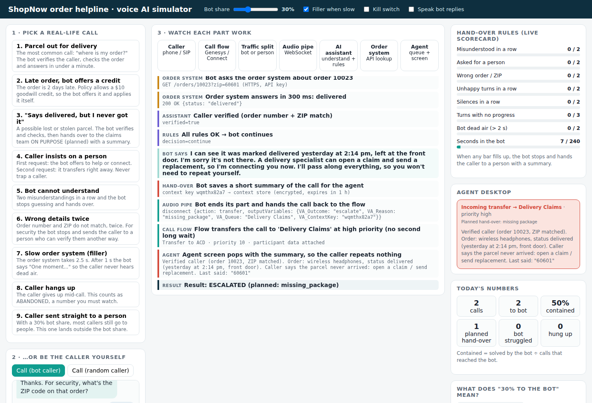
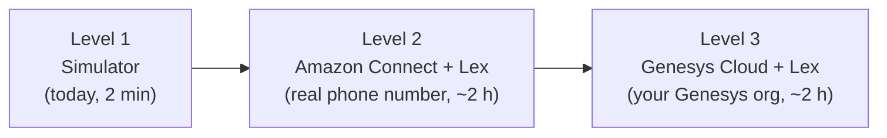

# ShopNow "Where is my order?" voice AI agent

A **working** voice AI phone agent for the most common call in retail, *"Where is my order?"* (WISMO).
You can **watch every step happen** in your browser, then run the same code for real on
**Amazon Connect** or **Genesys Cloud CX**.



## Why this use case?

- Order-status questions are **25–35% of contact-center calls**, rising to **50% in peak season** ([Aircall](https://aircall.io/blog/ai-order-agent/)).
- A person answering one costs roughly **$5–12 per call**, for about two minutes of real work ([Fini](https://www.usefini.com/guides/ai-phone-agents-order-status-calls)).
- It is the first thing most voice AI vendors automate today: Aircall, Dialpad, PolyAI, Parloa, Telnyx and others all ship WISMO agents.
- Hard cases (lost parcels, damage, upset customers) **still need a person** ([Claimlane](https://www.claimlane.com/resources/blog/voice-ai-customer-service)), so the bot must know **when to hand over and how to pass context**. That is what this repo shows.

## See it working in 2 minutes (no accounts, no installs)

You need [Node.js 18+](https://nodejs.org) for options B to D (option A needs nothing).

| Option | Do this | You get |
|---|---|---|
| **A. Just open it** | Double-click `simulator/index.html` | The full simulator in your browser |
| **B. With your voice** | `npm start`, then open http://localhost:3000 in Chrome/Edge | Same, plus 🎤 speak as the caller and hear the bot |
| **C. In the terminal** | `npm run demo` | All 9 calls printed step by step |
| **D. Prove it works** | `npm test` | 16 automated checks (all 9 calls + the AWS Lambda) |

Then follow **[docs/03-run-the-simulator.md](docs/03-run-the-simulator.md)**: it tells you what to click and what to look for.

## What you are looking at

The simulator lights up each part as it works:

| Part | Simple meaning | Real-world technology |
|---|---|---|
| **Caller** | The customer's phone call | PSTN / SIP, audio as RTP/SRTP |
| **Call flow** | The "receptionist" that answers and routes | Genesys Architect flow / Amazon Connect flow |
| **Traffic split** | Decides: bot or person? (e.g. 30% to the bot) | `Random()` decision / Distribute-by-percentage / `src/allocator.js` |
| **Audio pipe** | Live audio between the call and the bot | Genesys Audio Connector (WebSocket) or Amazon Lex |
| **AI assistant** | Understands, decides, replies | `src/nlu.js` + `src/policy.js` + `src/brain.js` |
| **Order system** | Where the order data lives | Your OMS / Shopify / SAP API (`src/orders.js` here) |
| **Agent** | A person, with the bot's summary on screen | ACD queue + screen pop |

Plain-English explanation of all of this: **[docs/01-how-it-works-simple.md](docs/01-how-it-works-simple.md)**.

## The 9 real-life calls you can replay

| # | Call | What the bot does | Result |
|---|---|---|---|
| 1 | Parcel out for delivery | Verifies (order + ZIP), checks, answers | ✅ Contained |
| 2 | Order 2 days late | Apologises, offers and applies a $10 credit | ✅ Contained |
| 3 | "Says delivered, but I never got it" | Verifies, checks, hands to **Delivery Claims** with a summary | 🤝 Planned hand-over |
| 4 | Caller insists on a person | 1st ask: offers. 2nd ask: transfers | ↗️ Bot hands over |
| 5 | Bot can't understand | Two misses → transfers | ↗️ Bot hands over |
| 6 | Wrong order/ZIP twice | Stops for security → transfers | ↗️ Bot hands over |
| 7 | Slow order system | Says "One moment…" after 1 s (no dead air) | ✅ Contained |
| 8 | Caller hangs up | Counted as abandoned | ❌ Abandoned |
| 9 | Not offered to the bot | Goes straight to a person (outside the 30%) | 👤 Person |

The whole use case, solved step by step: **[docs/02-use-case-step-by-step.md](docs/02-use-case-step-by-step.md)**.

## Go live in three levels



- **Level 2:** [docs/04-amazon-connect-step-by-step.md](docs/04-amazon-connect-step-by-step.md). Upload `deploy/lex-fulfillment.zip` to AWS Lambda, build a Lex bot, call your number.
- **Level 3:** [docs/05-genesys-cloud-step-by-step.md](docs/05-genesys-cloud-step-by-step.md). Same Lex bot, called from a Genesys Architect flow.
- **Before real customers:** [docs/06-going-live-simple.md](docs/06-going-live-simple.md) covers how much traffic to send, which numbers to watch, the hand-over rules and the security checklist.

The **same brain code** (`src/`) runs in the simulator and in the Lambda, so what you test is what goes live.

## Repo map

```
simulator/index.html   the visual simulator (open in a browser)
simulator/server.js    tiny web server for "npm start" (needed for the microphone)
src/brain.js           the conversation: ask, verify, look up, answer, hand over
src/nlu.js             understanding: intent, order number, ZIP, mood
src/policy.js          hand-over rules (the limits you can tune)
src/allocator.js       traffic split: "30% to the bot", sticky per caller, holdout
src/orders.js          pretend order system with 5 test orders
src/scenarios.js       the 9 demo calls
lambda/index.js        AWS Lambda for Amazon Lex (wraps src/brain.js)
deploy/                ready-to-upload Lambda zip, test event, IAM policy example
docs/                  step-by-step guides in plain English
test/all.test.js       16 automated checks (npm test)
```

## Try changing things

- Move the **Bot share** slider to 50% and press **Simulate 100 callers**.
- Untick **Filler when slow**, play call 7 and watch the *Bot dead air* bar.
- In `src/policy.js`, change `agentRequestsBeforeTransfer: 2` to `1`, reload and play call 4.
- Add your own order to `src/orders.js` and call about it.

## Put it on GitHub

```bash
cd order-helpline-voice-ai
git init && git add . && git commit -m "ShopNow WISMO voice AI agent"   # skip if already a git repo
gh repo create order-helpline-voice-ai --public --source . --push       # GitHub CLI
# or: create an empty repo on github.com, then
# git remote add origin https://github.com/<you>/order-helpline-voice-ai.git && git push -u origin main
```

A GitHub Actions workflow (`.github/workflows/test.yml`) runs `npm test` on every push.

---
The order data, company name and phone numbers are fictional. MIT licence.
