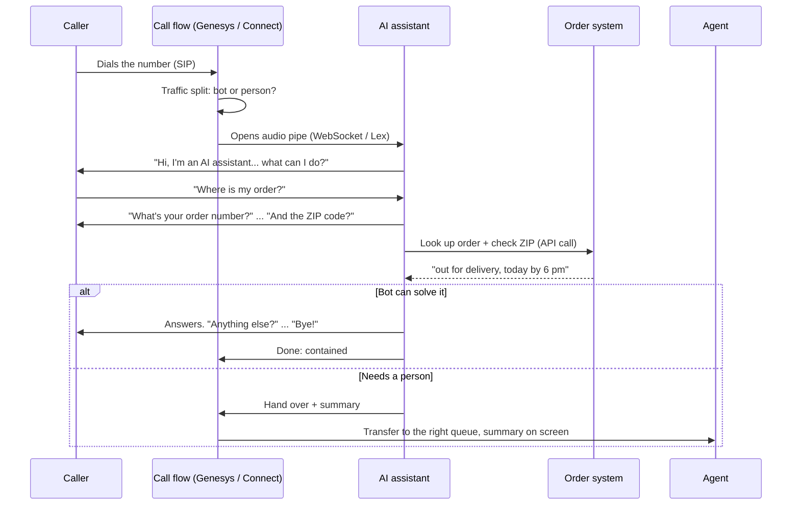

# How it works, in simple terms

## The picture

Think of a contact center as an **office building**:

| In the building | In the contact center |
|---|---|
| The street outside | The phone network (PSTN) |
| The front door | The phone number, connected by **SIP** (the language phones use to set up calls) |
| The receptionist who decides where you go | The **call flow** (Genesys "Architect" or an Amazon Connect "flow") |
| A sign: "3 out of 10 visitors please use the self-service desk" | The **traffic split** (e.g. 30% to the bot) |
| A speaking tube between reception and the self-service desk | The **audio pipe**: a **WebSocket** (Genesys Audio Connector) or Amazon Lex |
| The self-service assistant | The **AI assistant** (this repo's `src/brain.js`) |
| The filing room with all order records | The **order system / API** (here `src/orders.js`) |
| A note the assistant hands to the staff member | The **hand-over summary** (screen pop) |
| The waiting line for staff | The **queue** (ACD) |

**CCaaS** ("Contact Center as a Service") is simply the building rented in the cloud: Genesys Cloud CX and Amazon Connect are both CCaaS.

## One call, end to end

## The words you will hear, in one line each

| Word | Meaning |
|---|---|
| **SIP** | How phone systems agree to start, transfer and end a call. |
| **RTP / SRTP** | The actual sound packets (SRTP = encrypted). |
| **SBC** | A "security guard" box between phone networks. |
| **WebSocket (wss)** | A permanent two-way connection over the internet; used to stream live audio to a bot. |
| **WebRTC** | Real-time voice inside a web browser or app (e.g. "call us" button on a website). |
| **Webhook / data action** | The call flow asking another system a question over the internet (e.g. "is this a VIP?"). |
| **UUI** | A tiny note attached to a call when it moves between systems (we put a reference key in it). |
| **Intent** | What the caller wants ("track order", "parcel missing"). |
| **Speech-to-text / text-to-speech** | Turning voice into words, and words back into voice. Amazon Lex does both for you. |
| **Containment** | Calls the bot solved on its own ÷ calls that reached the bot. |
| **Escalation / hand-over** | The bot passes the caller to a person. *Planned* = by design; *forced* = the bot struggled. |
| **Abandon** | The caller hung up before being helped. |
| **Barge-in** | The caller talks over the bot; the bot must stop and listen. |
| **Dead air** | Silence on the line; over about 2 seconds it feels broken. |

## Why the bot hands over (the "scorecard")

The bot keeps a small scorecard during every call (you see it live in the simulator).
When any line reaches its limit, it stops trying and transfers **with a summary**:

| The bot hands over when... | Limit |
|---|---|
| It misunderstood the caller | 2 times in a row |
| The caller asked for a person | 2nd time (or 1st time if upset) |
| Order number / ZIP did not match | 2 times |
| The caller sounded unhappy | 2 turns in a row |
| The caller was silent | 2 times in a row |
| Nothing moved forward | 3 turns |
| The bot itself was silent too long (over 2 s) | 2 times |
| The bot conversation ran long | 240 seconds |
| The topic is sensitive (fraud) | immediately |

Change these numbers in `src/policy.js` and watch the behaviour change.

## Two ways to plug the bot into a real call

1. **Amazon Lex (easiest, used in Levels 2 and 3).** Lex listens, turns speech into text, sends the text to our Lambda (`lambda/index.js`), and speaks our reply. Both Amazon Connect and Genesys Cloud have a ready-made "talk to a Lex bot" step.
2. **Genesys Audio Connector (advanced).** Genesys streams raw audio over a WebSocket to your own service, which runs speech AI (for example Amazon Nova Sonic). More flexible and more natural, but more to build. The "audio pipe" events in the simulator show those WebSocket messages (`open`, `opened`, `disconnect`, `closed`).
