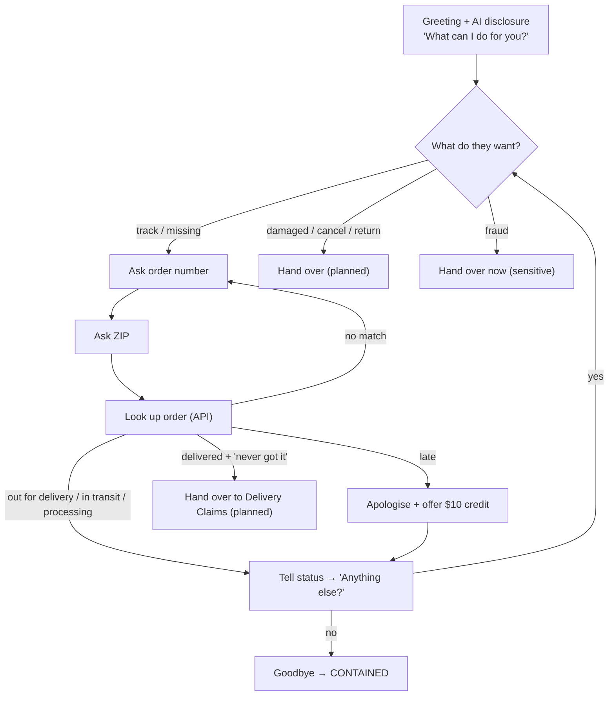

# The use case, solved step by step: "Where is my order?"

## Step 1. The problem

ShopNow (a fictional online retailer) gets thousands of calls a day. A third of them ask the same thing:
*"Where is my order?"* Each takes an agent several minutes (verify, search, read out) for a 30-second answer.
In peak season the queue explodes, wait times rise, and callers hang up.

## Step 2. The goal, in numbers

| Goal | Target for the pilot |
|---|---|
| Share of calls offered to the bot | start at 5–10%, grow to 30% |
| Calls solved by the bot (containment) | 60%+ of the calls it receives |
| Callers who hang up inside the bot | under 6% |
| Hand-overs because the bot struggled | under 10% |
| Callers who must repeat themselves after a hand-over | zero (summary on screen) |

## Step 3. Decide what the bot does and what it does NOT do

| The bot handles | The bot hands to a person (on purpose) |
|---|---|
| Out for delivery / in transit / not shipped yet | "Delivered but I never got it" → **Delivery Claims** |
| Late orders, including a $10 goodwill credit (within policy) | Damaged or wrong item → **Returns & Exchanges** |
| "Anything else?" for a second order | Cancel / return / change address → **Order Support** |
| | Possible fraud → **Fraud Team**, immediately |

Rule of thumb: **automate the routine; hand over the emotional, the risky and the unusual**, quickly and with context.

## Step 4. Decide how the caller proves who they are

Order number **plus** the ZIP code on the order. Two wrong attempts → a person verifies another way.
(Real systems often also match the caller's phone number to the account.)

## Step 5. Design the conversation

At **every** turn the hand-over rules (Step 6) are checked, so a struggling call can leave the bot at any point.

## Step 6. Set the hand-over rules

See the scorecard table in [01-how-it-works-simple.md](01-how-it-works-simple.md). Key ideas:

- **Never trap anyone.** First "agent!" → offer ("I can do it now, or connect you"). Second → transfer.
- **Two strikes.** Two misunderstandings, two wrong details or two silences → transfer.
- **No dead air.** If the order system is slow, say "One moment while I pull that up" after 1 second.
- **No double wait.** Transfers from the bot go in at **high priority**.

## Step 7. Hand over with context

When the bot hands over, it sends the flow: `VA_Outcome`, `VA_Reason`, `VA_Queue`, `VA_Summary`, `VA_ContextKey`.
The flow picks the queue and shows the summary to the agent, for example:

> **Incoming transfer → Delivery Claims** · priority high
> Verified caller (order 10023, ZIP matched). Order: wireless headphones, status delivered (yesterday at 2:14 pm, front door).
> Caller says the parcel never arrived: open a claim / send replacement.

## Step 8. Walk through each call (what happens under the hood)

### Call 1: parcel out for delivery → ✅ contained
1. Caller dials → **SIP** call reaches the call flow.
2. **Traffic split**: the caller's bucket is inside the 30% → bot.
3. **Audio pipe** opens; bot greets and says it is an AI.
4. "Hi, where is my order?" → understood as *track an order* (92% sure).
5. Bot asks for the order number, then the ZIP ("1 0 0 2 1" spoken digits work).
6. Bot calls the **order system**: `GET /orders/10021?zip=94107` → *out for delivery*.
7. Bot answers: "…arrive today by 6 pm. Anything else?" → "No, that's all" → goodbye.
8. Bot tells the flow `VA_Outcome = contained` → survey → call ends. **No agent used.**

### Call 2: late order → ✅ contained with a credit
Same as call 1 until the lookup returns *delayed, 2 days late*. The bot apologises and offers a $10 credit
(allowed by policy). "Yes please" → the bot calls `POST /orders/10022/credits` → confirms → goodbye.

### Call 3: "says delivered but I never got it" → 🤝 planned hand-over
The bot still verifies and checks (so the agent doesn't have to), sees *delivered, front door*, apologises, and
**hands over on purpose** to Delivery Claims with the summary. This is good automation: the agent
starts the claim immediately instead of spending 3 minutes on verification.

### Call 4: caller insists on a person → ↗️ hand-over
"Ugh, just get me a person" → rule *asked for a person 1/2* → bot offers. "No. A human, now." → *2/2* → transfer.

### Call 5: bot can't understand → ↗️ hand-over
"Hmm, I bought a thing" → not understood (1/2) → bot rephrases. Second miss (2/2) → transfer.

### Call 6: wrong details twice → ↗️ hand-over (security)
Order 10021 with ZIP 12345 → no match (1/2) → bot asks again → wrong again (2/2) → transfer to a person who can verify another way.

### Call 7: slow order system → ✅ contained, no dead air
The lookup takes 2.5 s. After 1 s the bot says "One moment while I pull that up." The *Bot dead air* bar stays at 0.
Untick **Filler when slow** and replay: the bar goes to 1/2. A second slow answer would hand the caller over.

### Call 8: caller hangs up → ❌ abandoned
Counted separately. If this number grows, something in the conversation is annoying people. Find which step using the event log.

### Call 9: not offered to the bot → 👤 person
The caller's bucket is outside the 30%. That is normal: with a 30% share, most callers still reach people,
and a 10% **holdout** never meets the bot, so you can compare results fairly.

## Step 9. Measure it

| Number | How | Healthy |
|---|---|---|
| Containment | contained ÷ calls to the bot | 60%+ for WISMO |
| Verified containment | contained **and** no repeat call within 72 h | close to containment |
| Abandon in bot | hung up in bot ÷ calls to the bot | < 6% |
| Bot struggled (forced hand-over) | forced ÷ calls to the bot | < 10% |
| Planned hand-over | planned ÷ calls to the bot | depends on your mix |

The simulator's **Today's numbers** panel computes the first ones live as you play calls.

## Step 10. What it is worth (example)

10,000 WISMO calls a month × 30% to the bot × 70% contained = **2,100 calls a month** handled with no agent.
At $5–12 per agent-handled call that is about **$10,000–25,000 a month** before bot costs.
