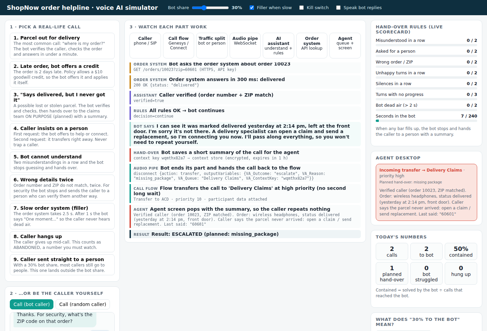

# Run the simulator and watch each part work

## 1. Open it

- **Quickest:** double-click `simulator/index.html`.
- **With microphone and voice:** in a terminal, inside the repo folder, run `npm start` and open
  **http://localhost:3000** in Chrome or Edge. (Browsers only allow the microphone on `localhost` or HTTPS.)



## 2. Find your way around the screen

| Area | What it shows |
|---|---|
| **1 · Pick a real-life call** (left) | 9 recorded situations. Click one and it plays by itself. |
| **2 · …or be the caller** (left) | Start a call and type (or 🎤 speak) as the customer. |
| **3 · Watch each part work** (middle) | The 7 parts light up in order; the log explains each step in plain English, with the real technical detail in grey below. |
| **Hand-over rules** (right) | The live scorecard. When a bar fills, the bot hands over. |
| **Agent desktop** (right) | What the agent sees when a call is transferred. |
| **Today's numbers** (right) | Calls, contained %, planned vs "bot struggled" hand-overs, hang-ups. |
| **What does 30% mean?** (right) | Simulates 100 callers to show the traffic split. |
| Top bar | Bot share slider, filler on/off, kill switch, read replies aloud. |

## 3. Five things to try (5 minutes)

1. **Play call 1.** Watch the parts light up left to right: Caller → Call flow → Traffic split → Audio pipe → AI assistant → Order system → back to the AI assistant. Result: *CONTAINED*.
2. **Play call 3.** At the end the **Agent** box lights up and the **Agent desktop** shows the summary. This is a *planned* hand-over.
3. **Play call 4.** Watch *Asked for a person* go 1/2 (offer) then 2/2 (transfer).
4. **Untick "Filler when slow", play call 7.** The *Bot dead air* bar moves. Tick it again and replay: it stays at 0.
5. **Set Bot share to 50%, press "Simulate 100 callers".** About 45 meet the bot (50% of the 90 outside the holdout).

## 4. Be the caller

Press **Call (bot caller)**, then type, for example:

```
where is my package
10025
98101
no that's all
```

Test orders:

| Order | ZIP | Situation |
|---|---|---|
| 10021 | 94107 | out for delivery |
| 10022 | 10001 | 2 days late (credit offered) |
| 10023 | 60601 | delivered, "missing" → claims |
| 10024 | 73301 | not shipped yet |
| 10025 | 98101 | slow order system (2.5 s) |

Also try: "this is ridiculous", "agent", **Press 0**, **Stay silent** twice, or a wrong ZIP twice.

## 5. Terminal version

```bash
npm run demo            # all 9 calls
npm run demo -- missing # just one (ids: happy late missing agent confused verify slow hangup human)
npm test                # 16 automated checks
```
