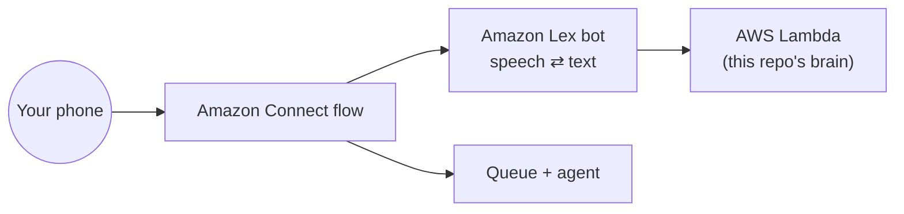

# Level 2: run it for real on Amazon Connect (about 2 hours)

You will call a real phone number and talk to the same bot you saw in the simulator.



**You need:** an AWS account with admin rights, and a Region that has Amazon Connect and Amazon Lex V2
(for example US East, N. Virginia). Connect, Lex and Lambda are pay-per-use; check the AWS pricing pages first.
Console labels change from time to time, so look for the closest match if a button name differs.

---

## Step 1. Create the Lambda (the bot's brain)

1. In a terminal inside the repo: `npm run package:lambda` (or use the ready-made `deploy/lex-fulfillment.zip`).
2. AWS console → **Lambda** → **Create function** → *Author from scratch*.
   - Name: `shopnow-wismo-brain` · Runtime: **Node.js 22.x** (20.x also works) → **Create function**.
3. **Code** tab → **Upload from** → **.zip file** → choose `deploy/lex-fulfillment.zip` → **Save**.
   Handler stays `index.handler`.
4. **Test** tab → new event → paste the contents of `deploy/test-event-lex.json` → **Test**.

✅ **You should see:** a response with `"type": "ElicitIntent"` and the message *"…What's your 5-digit order number?…"*.

## Step 2. Create the Amazon Lex bot (the bot's ears and voice)

1. AWS console → **Amazon Lex** → **Create bot** → *Create a blank bot*.
   - Name: `ShopNowOrderHelp` · IAM: *Create a role with basic Amazon Lex permissions* · COPPA: **No** · Idle timeout: 5 minutes → **Next**.
   - Language: **English (US)**, pick a voice (e.g. *Danielle* or *Joanna*), **Intent classification confidence threshold 0.40** → **Done**.
2. Edit the first intent and name it **`OrderHelp`**. Add these sample utterances (one per line):
   ```
   where is my order
   track my order
   order status
   where is my package
   my order is late
   it says delivered but I never got it
   my package never arrived
   I want to speak to an agent
   ```
   Under **Code hooks**, tick **Use a Lambda function for initialization and validation**. **Save intent.**
3. **Add intent** → *Add empty intent* → `OrderResolved`. Add one utterance nobody will say, such as `order resolved internal`. **Save.**
4. **Add intent** → *Add empty intent* → `EscalateToAgent`, utterance `escalate internal`. **Save.**
5. Open **FallbackIntent** → **Fulfillment** → turn on **Use a Lambda function for fulfillment** (so order numbers and ZIPs that land here still reach the brain). **Save.**
6. **Build** (top right). Wait for *Successfully built*.
7. Left menu → **Aliases** → `TestBotAlias` → **Languages** → *English (US)* → **Source:** `shopnow-wismo-brain`, version `$LATEST` → **Save**.
8. Back on the intent page → **Test** → type `where is my order`, then `10021`, then `94107`.

✅ **You should see:** the bot asks for the order number, then the ZIP, then says the running shoes are out for delivery.
If you see an access error, open the Lambda → **Configuration** → **Permissions** → **Add permission** for principal `lexv2.amazonaws.com`.

## Step 3. Prepare Amazon Connect

1. AWS console → **Amazon Connect** → create an instance (or use an existing test one) and log in to its admin website.
2. **Channels → Phone numbers → Claim a number** (a DID in your country). You will attach the flow in Step 5.
3. **Routing → Queues → Add queue**, three times: `Order Support`, `Delivery Claims`, `Returns & Exchanges`.
4. **Users → Routing profiles**: add the three queues to your own routing profile so calls reach you.
5. AWS console → Amazon Connect → your instance → **Flows** → **Amazon Lex** → choose `ShopNowOrderHelp` and `TestBotAlias` → **Add Amazon Lex Bot**.

## Step 4. Build the call flow

Admin website → **Routing → Flows → Create flow** → name `ShopNow WISMO`. Add these blocks in order:

| # | Block | Settings | Why |
|---|---|---|---|
| 1 | **Set logging behavior** | Enable | See every step in CloudWatch |
| 2 | **Set voice** | English (US), same voice as Lex, neural | Consistent voice |
| 3 | **Distribute by percentage** | **30%** → block 4 · remaining → block 8 | The traffic split |
| 4 | **Get customer input** | Text-to-speech: *"Hi, thanks for calling ShopNow. I'm an AI assistant, and this call is recorded. I can track an order or help if a delivery went wrong. What can I do for you?"* · **Amazon Lex** tab: bot `ShopNowOrderHelp`, alias `TestBotAlias` · **Session attributes:** key `callerPhone`, value *dynamic* `$.CustomerEndpoint.Address` · **Intents:** add `OrderResolved` and `EscalateToAgent` | Hands the call to the bot |
| 5 | On **OrderResolved** → **Disconnect** | | The bot already said goodbye |
| 6 | On **EscalateToAgent** → **Set contact attributes** | User-defined `va_summary` = Lex session attribute `va_summary`; same for `va_reason`, `va_queue`, `va_order` | Carries the context |
| 7 | **Check contact attributes** | `va_queue` equals `Delivery Claims` → **Set working queue** *Delivery Claims*; equals `Returns & Exchanges` → *Returns & Exchanges*; no match → *Order Support*. Then **Change routing priority** to **1** (highest) | Right team, no second long wait |
| 8 | **Set working queue** *Order Support* (for the 70% and for Error/Default branches) | | Everyone else |
| 9 | **Transfer to queue** | | Connect to an agent |

Connect every **Error** branch to block 8 → 9, so nobody is ever dropped. **Save** and **Publish**.

## Step 5. Attach the number and call it

1. **Channels → Phone numbers** → your number → **Flow / IVR:** `ShopNow WISMO` → **Save**.
2. Log in to the agent workspace (CCP), set yourself **Available**.
3. Call the number. 30% of calls reach the bot. For testing, temporarily set block 3 to **100%**.
4. Try the simulator scenarios by voice: say *"where is my order"*, *"one zero zero two one"*, *"nine four one zero seven"*.
   Then try order **10023** / **60601** and say it never arrived. Your agent phone rings and the
   contact attributes contain the summary.

✅ **Where to look:**
- **Lambda → Monitor → View CloudWatch logs:** one line per turn listing what the brain did.
- **Analytics → Contact search** → your call → **Attributes**: `va_summary`, `va_reason`, `va_queue`.
- To show attributes on the agent's screen during the call, enable them in your agent workspace
  (for example a step-by-step guide view); otherwise they're always visible in Contact search.

## Notes

- **Distribute by percentage** is random per call. For a *sticky* split (the same caller always gets the same experience), call a small Lambda that uses `src/allocator.js`.
- To use your real order system, replace the body of `lookupOrder()` in `src/orders.js` with a call to your API, rebuild the zip and re-upload.
