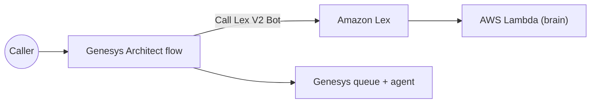

# Level 3: run it on Genesys Cloud CX (about 2 hours)

Same bot, same Lambda: Genesys Cloud calls the Amazon Lex bot from an Architect flow.
**Do Level 2, Steps 1–2 first** (Lambda + Lex bot). You don't need Amazon Connect for this level.

**You need:** Genesys Cloud admin rights (Integrations, Architect, Queues, Telephony) and the AWS account
from Level 2. Genesys menu names below are as of late 2026; look for the closest match if they differ.

---

## Step 1. Let Genesys use your Lex bot (AWS IAM role)

1. Open the Genesys Resource Center article **"Configure IAM role with permissions for Amazon Lex V2"** and note
   **the Genesys AWS account ID** for your region. (Copy it from that article; don't guess.)
2. AWS console → **IAM → Roles → Create role** → *AWS account* → *Another AWS account* → paste that account ID →
   tick **Require external ID** → enter **your Genesys Cloud organization ID**.
3. Permissions: create a policy from `deploy/genesys-lex-iam-policy.json`, checked against the article's list. Name the role `GenesysLexV2Access`.
4. Copy the **role ARN**.

## Step 2. Install the Lex V2 integration in Genesys

1. Genesys Cloud → **Admin → Integrations → + Integrations** → **Amazon Lex V2** → **Install**.
2. **Configuration → Credentials** → paste the role ARN → **OK** → set the integration **Active**.

✅ In Architect, the **Call Lex V2 Bot** action now lists `ShopNowOrderHelp`.

## Step 3. Create the queues

**Admin → Contact Center → Queues**: `Order Support`, `Delivery Claims`, `Returns & Exchanges`. Add yourself as a member of each.

## Step 4. Build the Architect flow

**Architect → Inbound Call Flow → + Add** → `ShopNow WISMO`. In the starting task add:

| # | Action | Settings | Why |
|---|---|---|---|
| 1 | **Decision** | Expression: `Random() < 0.30` | Traffic split: Yes ≈ 30% to the bot |
| 2 | (Yes) **Call Lex V2 Bot** | Bot `ShopNowOrderHelp`, alias `TestBotAlias`, locale English (US). Greeting: *"Hi, thanks for calling ShopNow. I'm an AI assistant, and this call is recorded…"* (use the action's initial prompt, or a **Play Audio** action just before it). **Input session attributes:** `callerPhone` = `Call.Ani` | Hands the call to the bot |
| 3 | Intent path **OrderResolved** → **Disconnect** | | Solved by the bot |
| 4 | Intent path **EscalateToAgent** → **Update Data** | Save the bot's output session attributes `va_queue`, `va_summary`, `va_reason`, `va_order` into flow variables (if your version only exposes intent and slots, use `Order Support` as the queue) | Carries the context |
| 5 | **Set Participant Data** | `va_summary`, `va_reason`, `va_order` | The agent can see them |
| 6 | **Find Queue** by name `Flow.va_queue` → **Transfer to ACD** | Raise **Priority** (e.g. `10`) | Right team, no second long wait |
| 7 | (No path from step 1, the **Failure** path of step 2, and failure of step 6) → **Transfer to ACD** `Order Support` | | Nobody is ever dropped |

**Publish** the flow.

## Step 5. Attach a number and call

1. **Admin → Telephony → Call Routing** → route a test number (DID) to `ShopNow WISMO`.
2. Go **On Queue** in Genesys Cloud, call the number, and run the same tests as Level 2.
3. Optional: build a small **Script** that shows `va_summary`, set it as the default script on the three queues, so the summary pops on the agent screen.

✅ **Where to look:** Interaction details → participant data (`va_summary`, `va_reason`), and the Lambda's CloudWatch logs.

---

## Advanced (later): natural speech-to-speech with the Audio Connector

Instead of Lex, Genesys can stream live audio over a **WebSocket** (the *Audio Connector* integration) to
your own service running a speech-to-speech model such as Amazon Nova Sonic. It sounds more natural but you
build and host the audio bridge yourself. The simulator's **Audio pipe** events show the messages involved
(`open` → `opened` → audio → `disconnect` → `close` → `closed`). Keep the same `src/policy.js` rules and
the same output variables (`VA_Outcome`, `VA_Reason`, `VA_Queue`, `VA_Summary`) so the Architect flow barely changes.
