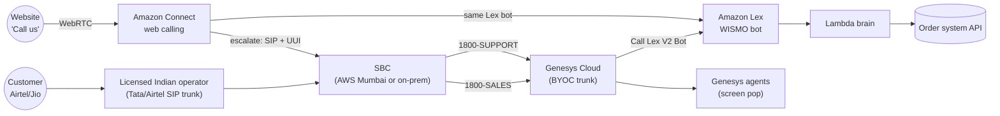

# Use case v2: ShopNow India on Genesys + Amazon Connect (building blocks first)

## The situation

ShopNow (fictional) is an Indian online retailer:
- **Sales** (pre-purchase questions) runs on **Genesys Cloud** today, with 120 agents.
- Leadership wants to try **AWS AI** (Amazon Lex, later Nova Sonic) for the top call type, *"Where is my order?"*.
- Customers call on **Airtel, Jio, Vi and BSNL** mobiles and landlines. Some click **"Call us"** on the website.
- Rules: Indian licensed telephony, CDRs kept in India, outbound promotions on **140-series** numbers.

## The design, in one picture

Why this shape:
1. **Telephony lands on Genesys**, because Genesys accepts an Indian operator's SIP trunk (BYOC) and Amazon Connect does not.
2. **AI comes from AWS without moving calls:** Genesys calls the Lex bot directly. No cross-platform transfer for phone calls.
3. **Amazon Connect handles the web/app channel** (WebRTC "Call us"), using the **same Lex bot**. When those callers need a person, Connect transfers to Genesys agents over private SIP with a UUI key (the one cross-platform path, kept for escalations only).
4. **Split at the edge:** the SBC routes by dialled number (Sales vs Support), so most calls never cross platforms.

## Build it in phases

### Phase 1: building blocks (no AI yet)

| Step | Building block | Done when | Explorer journey |
|---|---|---|---|
| 1.1 | Operator SIP trunk (Tata/Airtel) to the SBC over a dedicated circuit | Test call reaches the SBC (SIP INVITE seen) | 1 |
| 1.2 | SBC → Genesys BYOC trunk (TLS 5061, SRTP) | Call answered by a simple Architect flow | 1 |
| 1.3 | Number-based routing: 1800-SALES and 1800-SUPPORT to different flows | Each number reaches its own queue | 1 + split panel |
| 1.4 | Outbound: agent call-back through the same trunk with an approved caller ID | Customer phone rings with the right number | 6 |
| 1.5 | Amazon Connect web calling (WebRTC) on a test page | Browser call reaches a Connect agent | 3 |
| 1.6 | Connect → SBC → Genesys external voice transfer with UUI | Genesys reads the key, fetches context, pops the agent screen | 2 |
| 1.7 | Failure paths: SBC down, trunk down, unknown key | Every failure lands in a queue, never a dropped call | 2 |

### Phase 2: the AI bot

| Step | What | Done when |
|---|---|---|
| 2.1 | Deploy `lambda/index.js` + Lex bot (`docs/04`, Steps 1–2) | Lex test console answers order 10021 |
| 2.2 | Genesys "Call Lex V2 Bot" in the Support flow (`docs/05`) | A real call is answered by the bot |
| 2.3 | Same bot in the Connect web-calling flow | Web caller gets the same answers |
| 2.4 | Summary on agent screens for every hand-over | Agents never re-ask verification questions |

### Phase 3: containment and optimisation (later)

Start with 5–10% of Support calls going to the bot, then grow (see `docs/06`). Tune the hand-over rules in `src/policy.js`, and measure verified containment and hang-ups against a holdout group.

## What to show in a demo

1. **Explorer, journey 1** (Airtel → Genesys → Lex): explain every building block in order.
2. **Explorer, journey 2** (Connect → Genesys with UUI): explain the one cross-platform path and why it exists.
3. **Explorer, split panel**: compare "by number" (0 transfers) with "front door + transfer" (every moved call paid twice).
4. **Explorer, journey 6** (outbound): India rules: licensed trunk, 140/1600 series.
5. **WISMO simulator, call 3**: the bot verifies, checks the order, and hands over with a summary.
6. Close with the phase plan: building blocks first, AI second, containment third.
